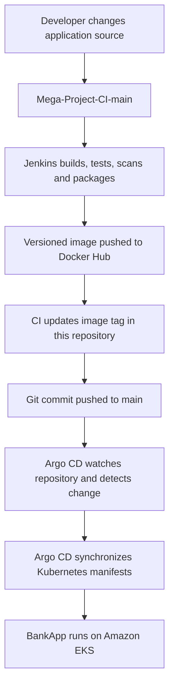

# BankApp – Continuous Delivery (CD) and GitOps

This repository contains the Kubernetes deployment configuration and Jenkins deployment pipeline for the Java/Spring Boot BankApp application running on Amazon EKS.

It is maintained separately from the application/CI repository so that the desired Kubernetes deployment state is stored in Git. The CI pipeline in [`Mega-Project-CI-main`](https://github.com/SurajKhanderao/Mega-Project-CI-main) publishes a versioned Docker image and updates the image tag in this repository. Argo CD can then detect the Git change and synchronize the manifests to the cluster.

## Project at a glance

- Application: BankApp (Java 17 / Spring Boot)
- Container registry: Docker Hub (`surajkhanderao/bankapp`)
- Platform: Kubernetes on Amazon EKS
- Deployment configuration: Kubernetes YAML manifests
- GitOps: Argo CD (configured to watch this repository)
- Deployment automation: Jenkins pipeline using `kubectl apply`
- Namespace used by the current Jenkins deployment pipeline: `webapps`

## How this repository fits into the complete project



This repository also includes a Jenkins CD pipeline that checks out the deployment repository and applies the manifests with `kubectl`. This provides a Jenkins-driven deployment path in addition to the Argo CD GitOps synchronization path. Choose and operate the deployment mechanism deliberately to avoid two controllers making conflicting changes.

## Repository structure

```text
Mega-Project-CD/
├── Manifests/          # Kubernetes application and supporting resource manifests
├── RBAC/               # Kubernetes RBAC resources used for access control
├── Jenkinsfile         # Jenkins pipeline for applying manifests to EKS
└── Readme.md
```

The CI pipeline specifically updates:

```text
Manifests/bankapp-deploy.yml
```

## Deployment workflow

### 1. Image tag update from CI

The CI pipeline builds an image using the Jenkins build number, pushes it to Docker Hub, and updates the image reference in `Manifests/bankapp-deploy.yml` in this repository.

Image naming convention used by the CI pipeline:

```text
surajkhanderao/bankapp:v<BUILD_NUMBER>
```

The Git commit in this repository records which image version is intended for deployment.

### 2. Argo CD GitOps synchronization

Configure an Argo CD Application to watch:

- Repository: `https://github.com/SurajKhanderao/Mega-Project-CD.git`
- Revision: `main`
- Path: the directory containing the Kubernetes manifests (currently `Manifests`)
- Destination: the intended EKS cluster
- Namespace: `webapps` (or the namespace configured in your manifests/Application)

When the image-tag commit is pushed, Argo CD can detect the change and synchronize the desired state to the cluster. The exact sync policy (manual or automated, pruning, and self-healing) is determined by the Argo CD Application configuration; it is not defined by the Jenkinsfile in this repository.

### 3. Jenkins-based manifest deployment

The current `Jenkinsfile` performs these operations:

1. Checks out the `main` branch of this CD repository.
2. Uses the Jenkins Kubernetes configuration credential to connect to the configured EKS cluster.
3. Runs `kubectl apply -f Manifests/.` in the `webapps` namespace.
4. Waits for 30 seconds.
5. Lists Pods, Services, and Ingress resources in the `webapps` namespace.

The pipeline currently applies the manifests and prints resource status. It does not currently run `kubectl rollout status` or verify application-level HTTP health. Consider adding explicit rollout and health checks before treating a deployment as successful.

## Kubernetes resources and configuration

The `Manifests/` directory contains the Kubernetes YAML used to deploy and expose the application and its supporting resources. The BankApp deployment configuration is intended to include items such as:

- Deployment and container image reference
- Service to expose the application inside the cluster
- Application container port `8080`
- CPU and memory requests/limits
- Liveness and readiness probes
- Database connection configuration
- Kubernetes Secret references for database credentials
- Ingress configuration, where enabled

The application Service may expose port `80` and forward traffic to the container's port `8080`; confirm the actual `port` and `targetPort` values in the Service manifest before configuring an Ingress or external load balancer.

The `RBAC/` directory contains Kubernetes role-based access control resources. Review the subject, namespace, Role/ClusterRole, and RoleBinding references to ensure that only the intended service account or user receives the required permissions.

## Prerequisites

- A running Amazon EKS cluster and working `kubectl` access.
- A Kubernetes namespace matching the manifests (the current Jenkins pipeline uses `webapps`).
- The BankApp image available in Docker Hub and referenced by the deployment manifest.
- Required Kubernetes Secrets created in the target namespace before deploying workloads that reference them.
- Argo CD installed and an Application configured if using the GitOps path.
- Jenkins with the required pipeline and Kubernetes configuration plugins if using the Jenkins deployment path.

## Deploy manually with kubectl

Clone the repository:

```bash
git clone https://github.com/SurajKhanderao/Mega-Project-CD.git
cd Mega-Project-CD
```

Check the active cluster and namespace:

```bash
kubectl config current-context
kubectl get nodes
kubectl get namespace webapps
```

Review the manifests and verify that image names, tags, namespaces, Service selectors, Secret names, and Ingress backend references are correct. Then apply them:

```bash
kubectl apply -f Manifests/ -n webapps
```

Check the deployment:

```bash
kubectl get deployments,pods,services,ingress -n webapps
kubectl rollout status deployment/<deployment-name> -n webapps
kubectl describe pod <pod-name> -n webapps
```

Use the actual Deployment and Pod names from the manifests/cluster.

## Jenkins configuration

The current CD pipeline references the following Jenkins configuration:

| Item | Value used by the Jenkinsfile |
|---|---|
| Git branch | `main` |
| Git credential ID | `git-cred` |
| Kubernetes credential ID | `jenkins-token` |
| Kubernetes namespace | `webapps` |
| Cluster name configured in pipeline | `sk-cluster` |

The Jenkins agent must have `kubectl` installed and configured, and the Jenkins installation must provide the `withKubeConfig` step/plugin. Configure the credential with access to the intended EKS cluster and namespace.

Before reusing the Jenkinsfile in another account or cluster, update the cluster connection settings to match that environment. Prefer managing cluster connection details and credentials through Jenkins configuration/credentials rather than committing environment-specific endpoints or sensitive information to Git.

## Important configuration and security checks

- **Secrets:** Do not commit database passwords, access keys, tokens, or other credentials in YAML or source control. Create the required Kubernetes Secret securely in the target namespace or use an approved external secret-management integration.
- **Image tag:** Confirm that the image tag in `Manifests/bankapp-deploy.yml` exists in Docker Hub before syncing.
- **Ingress:** Ensure the Ingress host, path, IngressClass, backend Service name, and backend Service port match the resources actually deployed. The Ingress must reference the BankApp Service, not a service name from another application.
- **Namespace:** Keep the namespace consistent across the manifests, Argo CD Application destination, Secrets, and Jenkins deployment configuration.
- **RBAC:** Apply least privilege. Avoid granting cluster-wide permissions when namespace-scoped access is sufficient.
- **Deployment ownership:** If Argo CD and Jenkins both apply the same resources, define which system is authoritative and avoid manual edits that cause Git/cluster drift.

## Troubleshooting

- **Pods are not starting:** Check `kubectl describe pod`, container logs, image tag, resource requests/limits, probes, and Secret references.
- **ImagePullBackOff:** Verify that the image and tag exist and that the cluster can pull the image.
- **Database connection errors:** Confirm the database Service name, port, credentials Secret, and application environment configuration.
- **Ingress returns 404:** Verify the IngressClass, host rule, path, backend Service name, and Service port. Also check the Ingress controller logs and events.
- **Argo CD does not sync:** Verify the repository URL, branch, manifest path, destination cluster, namespace, and Application sync status.
- **Jenkins deployment fails:** Check the `jenkins-token` credential, EKS access permissions, namespace, `kubectl` installation, and Jenkins Kubernetes plugin configuration.

## Related repository

- [Mega-Project-CI-main – Java application and CI pipeline](https://github.com/SurajKhanderao/Mega-Project-CI-main)

---

This is a hands-on Kubernetes delivery/GitOps project. Review the manifests, Jenkins configuration, cluster permissions, and environment-specific settings before deploying to another cluster.
